<style>
body {text-align: justify}
</style>

## Resumen

Para este proyecto, utilizamos una implementación de BFGS escrita en python para encontrar los coeficientes de máxima verosimilitud de una regresión logística. El método de BFGS es un método que aproxima la Hessiana para generar una dirección de descenso de manera más rápida que el método de Newton en general. Utilizamos una base de datos de derrames cerebrales, tratando de predecir a través de algunos datos si una persona tendrá un derrame cerebral o no. Además, presentamos los resultados de convergencia del método en este caso en particular, y analizamos contra la implementación de scipy.

## Introducción

Los métodos de Cuasi-Newton son una clase de métodos que empezaron a desarrollarse alrededor de los años 1950 por falta de poder computacional y memoria que tenían las computadoras en esa época. Desde entonces, cientos de artículos se han escrito sobre métodos de aproximación a derivdadas de segundo orden, y adaptaciones al método original. Uno de esos métodos es BFGS, llamado así por la gente que primero lo desarrolló, Broyden, Fletcher, Goldfarb y Shanno.

Los métodos de cuasi-Newton, tal como los métodos de decenso por gradiente, solamente utilizan el gradiente de la función objetivo para poder iterar y llegar a aproximaciones de los puntos óptimos locales. La mejora en algunos escenarios sobre métodos de decenso por gradiente es considerable, especialmente cuando los problemas tienen muchas dimensiones o las funciones a aproximar son extremadamente complejas. Otro beneficio para este tipo de métodos es que como no se requiere una segunda derivada, entonces son generalmente mas eficientes que los métodos de Newton, que la calculan para cada iteración.

Existen implementaciones de herramientas para el cálculo automático de gradientes y Hessianas (como [1]) que resuelven de forma analítica la segunda derivada de una función, y esto ha generado competencia para los métodos de decenso por cuasi-Newton. No obstante, siguen teniendo un lugar en el mundo, ya que hay muchas veces que la eficiencia de hacer aproximaciones es mucho más importante que la exactitud extra que se puede generar usando estos otros métodos.

En este proyecto, explotamos las fortalezas de este tipo de métodos generando una implementación del método BFGS para resolver un problema de estimación de máxima verosimilitud. En particular, hacemos una regresión logística, y ajustamos los parámetros para poder minimizar la pérdida logarítmica del ajuste del modelo. Esto se hace resolviendo un problema de minimización en términos de los valores de los coeficientes del modelo. A continuación, presentamos con más detalle el problema a resolver, hacemos una descripción general del método BFGS, y presentamos las soluciones que obtuvimos. Finalizamos presentando los tests que hicimos y concluimos con algunas recomendaciones a futuro.

## Problema a Resolver

Los datos utilizados en este problema son referentes a derrames cerebrales (*stroke*), la segunda mayor causa de muerte a nivel mundial de acuerdo con la Organización Mundial de la Salud (OMS). La base de datos fue obtenida de Kaggle y lleva por nombre Stroke Prediction Dataset. Con el modelo desarrollado utilizamos características importantes sobre los pacientes para predecir la ocurrencia de un derrame. Las variables predictoras son:

* gender: genero del paciente.
* age: edad del paciente.
* hypertension: 0 si no padece o 1 si padece hipertensión.
* heart_disease: 0 si padece o 1 si padece una enfermedad cardiaca.
* ever_married: alguna vez casado (sí o no).
* residence_type: tipo de residencia rural o urbana.
* avg_glucose_level: nivel de glucosa promedio en sangre.
* bmi: índice de masa corporal.
* smoking_status: fumador, ha fumado, nunca fuma o desconocido.

Y la variable a predecir:

* stroke: 1 si el paciente tuvo un derrame o 0 si no.

La variable a predecir es categórica con dos niveles, por lo que el modelo elegido para clasificación es regresión logística.

En este modelo las variables predictoras son X, mientras que Y son las dos posibles categorías (0 o 1). El modelo de regresión logística predice la probabilidad de que la Y pertenezca a alguna de las dos categorías posibles. Para definir un modelo p(X), partimos de un promedio ponderado de las variables predictoras:

$$\beta_0+\beta_1x_1+\beta_2x_2+...+\beta_nx_n$$
Esta expresión es transformada por la función sigmoide o logística:

$$h(x) = \frac{1}{1+e^{-x}}=\frac{e^x}{e^x+1}$$
```{r,echo=FALSE}
x <- seq(-5, 5, 0.001)

plot(x, 1/(1+exp(-x)), col='blue',ylab='Función logística')
abline(v=0, col="blue", lty=2, lwd=3)
abline(h=0, col="blue", lty=2, lwd=3)
```

Como se puede ver en la figura anterior, para valores negativos de x la función logística se acerca al valor de cero y para valores positivos de x la función toma valores cercanos a 1.

Entonces el modelo de regresión logística queda expresado con la siguiente ecuación:

$$p(x)=h\left(\beta_0+\beta_1x_1+\beta_2x_2+...+\beta_nx_n\right)$$
La siguiente pregunta sería, ¿cómo elegimos los coeficientes de nuestro modelo? Dado un conjunto de datos de entrenamiento, se espera que las probabilidades de clase obtenidas en la clasificación sean lo más cercanas posible al valor de sus correspondientes categorías. En otras palabras, se busca un error mínimo entre las predicciones de nuestro modelo y el valor de la variable objetivo. Para hacer esto, nos apoyamos de la siguiente función de costo utilizada en el problema de clasificación:

$$
Cost(h(X),Y)=\begin{cases} -log(h(X))\,\,\, si\,\,\, y=1\\\\-log(1-h(X))\,\,\, si\,\,\, y=0 \end{cases}
$$

Esta función puede ser reexpresada de la siguiente forma:

$$Cost(h(X),Y)=-\frac{1}{n}\left[\sum_{i=1}^{n}y_ilogh(x_i)+(1-y_i)log(1-h(x_i))\right]$$
donde n es la cantidad de datos en el conjunto de entrenamiento. 

Esta función generalmente es minimizada con un método iterativo ampliamente conocido como descenso en gradiente. Este método funciona bien y su implementación es relativamente sencilla, aunque para grandes conjuntos de datos llega a ser exigente computacionalmente. En este proyecto utilizamos un optimizador alternativo, conocido como BFGS en honor a sus autores. Este es un método Cuasi-Newton, el cual no requiere de una selección manual del tamaño de paso, tiene una convergencia más rápida que el descenso en gradiente y es más conveniente en términos computacionales.


## Método BFGS

El método más popular entre la clase de cuasi-Newton es el método BFGS y sus derivados. Este es un método de descenso, que formalmente, es un método que genera una secuencia de minimización de puntos $x^{(0)}, x^{(1)}, \ldots, x^{(n)} \in dom(f_0)$ con $f_0$ la función objetivo, con la característica de que $f_0(x^{(k+1)}) < f_0(x^{(k)})$ excepto para $x^{(k)}$ óptimo, y también, $f_0(x^{(k)}) \rightarrow p^*$ si $k \rightarrow \infty$.

El iterando $x^{(k)}$ se puede formar usando el teorema de Taylor el siguiente modelo cuadrático:
$$
m_k(p) = f_k + \nabla f_k^Tp + \frac{1}{2} p^T \nabla^2f_k p,
$$
donde $f_k = f_0(x^{(k)})$ es la función objetivo evaluado en el iterado $x^{(k)}$, y $p$ es la dirección de descenso. Lo que sigue entonces es hacer una aproximación a la Hessiana $\nabla^2 f_k \approx B_k$, donde $B_k \in \mathbb{R}^{n \times n}$ es una matriz simétrica positiva semiefinida que se actualiza a cada iteración. El problema es entonces:
$$
m_k(p) = f_k + \nabla f_k^Tp + \frac{1}{2} p^T B_k p.
$$
El elemento que resuelve este problema lo llamamos $p_k$, que es explicitamente
$$
p_k = - B_k^{-1} \nabla f_k.
$$
Notamos antes de continuar que esta dirección es muy parecida a la dirección de Newton, pero usamos la aproximación a la Hessiana en vez de la Hessiana en sí. Por lo tanto, la actualización del paso es entonces:
$$
x^{(k+1)} = x^{(k)} + \alpha_k p_k
$$
donde $\alpha_k$ es una longitud de paso que satisface las dos condiciones de Wolfe. Estas condiciones quedan fuera del rango de este trabajo, pero, una explicación detallada se puede encontrar en [NOCEDAL, 3.6]. El gran truco del método BFGS es esta matriz $B_k$. Para lidiar con los costos computacionales altos, se propuso en vez de calcular a cada iteración la Hessiana hacerle una actualización a esta matriz $B_k$. El desarrollo completo de esta actualización se puede ver en [NOCEDAL, 6.1], y es nombrada la actualización DFP:
$$
B_{k+1} = (I - \rho_k y_k s_k^T) B_k (I - \rho_k s_k y_k^T) + \rho_k y_k y_k^T,
$$
con
$$
\rho_k = \frac{1}{y_k^Ts_k},
$$
donde $y_k = \nabla f_{k+1} - \nabla f_k$, y $s_k = x_{k+1} - x_k = \alpha_k p_k$. Tomando $H_k = B_k^{-1}$ por su utilidad en el cálculo de la dirección de decenso, entonces podemos ver que la actualización que se usa en el método es:
$$
H_{k+1} = (I - \rho_k s_k y_k^T) H_k (I - \rho_k y_k s_k^T) + \rho_k s_k s_k^T,
$$
y generalmente para la inicialización del método se toma $H_0 = I_{n \times n}$.

Con este desarrollo, podemos entones definir el algoritmo de BFGS completo.

### Algoritmo BFGS

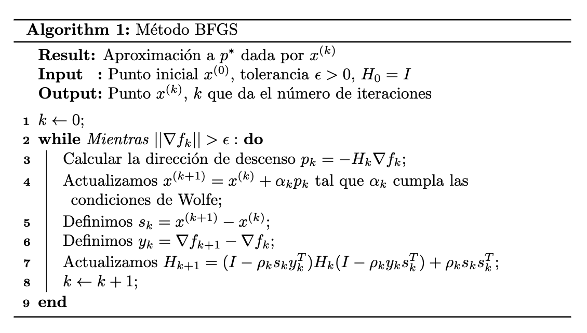

Notamos que el algoritmo tiene un costo computacional del orden $\mathcal{O}(n^2)$, y no hay operaciones de orden más alto, a comparación con el método de Newton, que es de orden $\mathcal{O}(n^3)$. Además, el algoritmo es robusto, lo cual significa que puede lidiar con errores durante la ejecución en algunos casos, e imputs erróneos, ya que la actualización de $H_k$ es bastante poderosa.

## Soluciones

Vemos que los coeficientes resultantes son prácticamente idénticos. Y con una tolerancia de $1e-5$ son idénticos:


Obtuvimos la cantidad de iteraciones y el valor de los coeficientes en cada iteración. El algoritmo corrió en  un total de 86 iteraciones. Las primeras 10 se ven así, todas  bastante variables pues están lejos de converger:

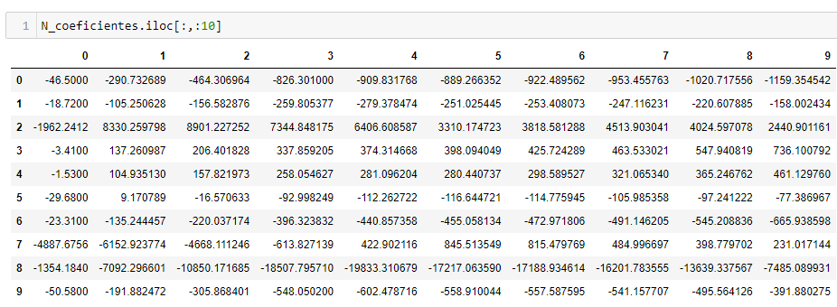

Las últimas 10 iteraciones se ven así, en las que prácticamente ya no hay variación:

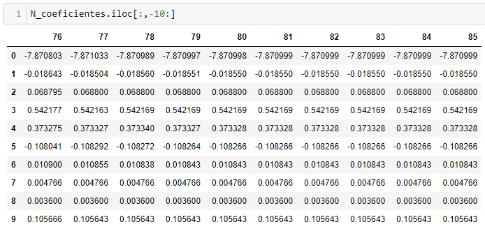

Graficamos para ver como los coeficientes van convergiendo:

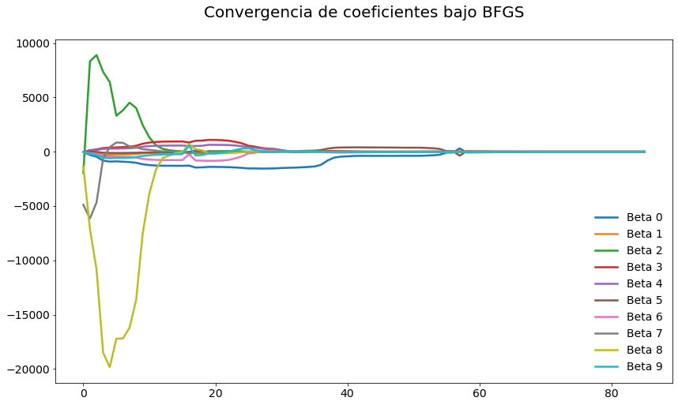

Vamos haciendo zoom progresivo para apreciar como se van reduciendo los coeficientes:

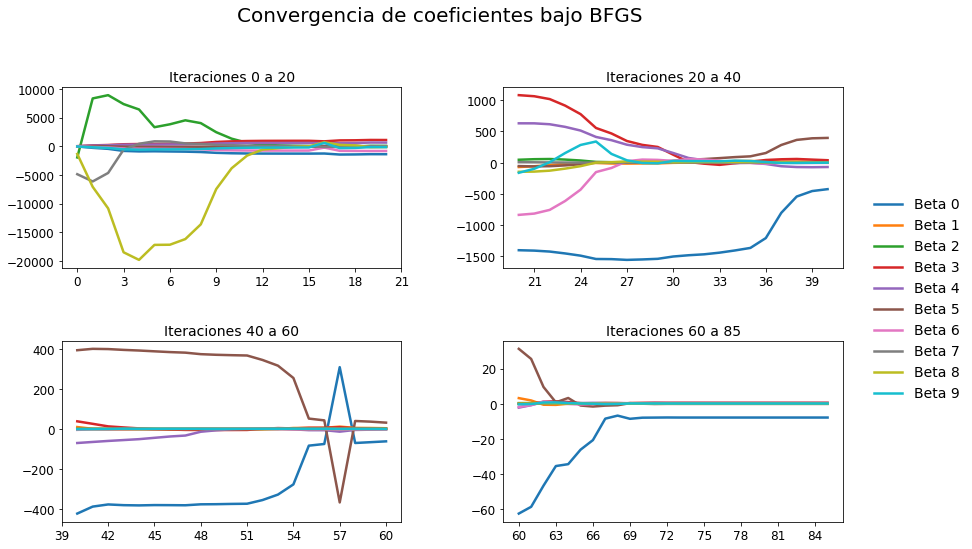

Podría además interesarnos como cambia el error relativo entre cada iteración. Graficamos para ver como se comportan los errores relativos de cada coeficiente. Es interesante notar que, aunque haya picos, no necesariamente significa que este mal, sino que fueron puntos de cambio importantes en que los coeficientes se ajustaron para converger:

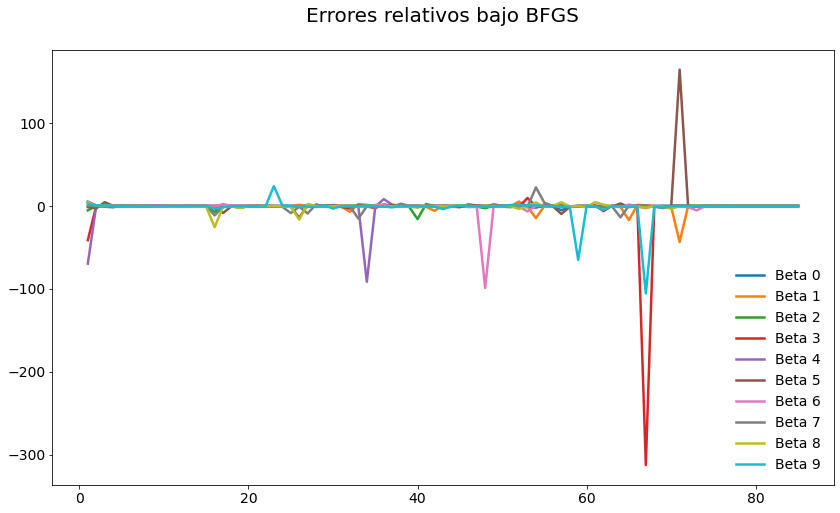

Vamos haciendo zoom progresivo:

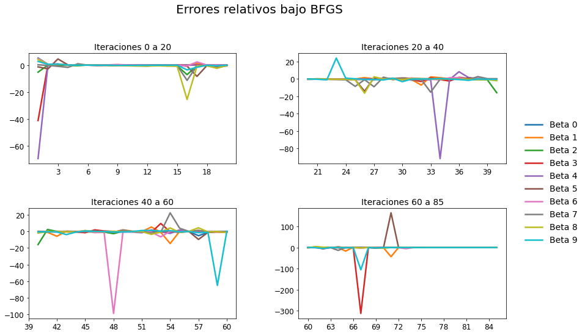

## Predicciones

Realizamos algunas predicciones con los coeficientes calculados para verificar que los resultados
sean coherentes.

Los coeficientes son los siguientes:

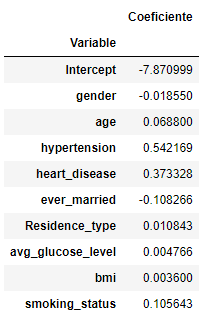

### Predicciones : Caso 1

El primer caso es un hombre de 25 años, relativamente saludable (sólo fuma considerablemente).

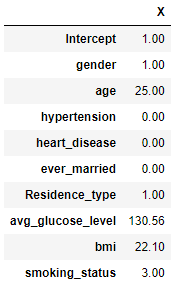

Podemos apreciar que en efecto la probabilidad de que este individuo tenga un derrame es bastante baja,
lo cual es esperado dado su condición física:

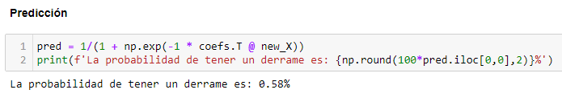

### Predicciones : Caso 2

El segundo caso es una mujer de 82 años, con varias condiciones desfavorables en su salud:

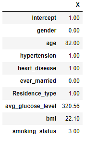

En este caso, la probabilidad de que este individuo tenga un derrame es considerablemente alta,
lo cual es esperado dado su condición física:

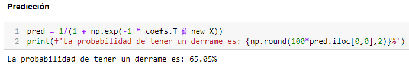

## Conclusiones

Para concluir, el método funcionó de manera muy buena. Podemos ver que tenemos más iteraciones que el método implementado por scipy, pero, fuera de eso, la convergencia es a los mismos puntos, y además, tenemos muy alta precisión (del orden de $\approx 10^{-6}$). Vemos además la potencia del método, ya que este es un problema relativamente complejo, por la forma de las funciones que involucran divisiones por exponentes, que rompen a muchos métodos numéricos. Algunas extensiones o proyectos siguientes pueden ser comparar este método contra otros métodos, particularmente BFGS de memoria limitada, o descenso en gradiente. Esto se puede comparar en términos del número de iteraciones que se realizan o el tiempo que toma a converger a un buen punto con la misma tolerancia.

\pagebreak

## Referencias 

* [Simpy](https://www.sympy.org/en/index.html)
* [Stroke-prediction-dataset](https://www.kaggle.com/fedesoriano/stroke-prediction-dataset)
* [scipy.optimize](https://docs.scipy.org/doc/scipy/reference/generated/scipy.optimize.minimize.html)
* [How to minimize with BFGS in Python?](https://stackoverflow.com/questions/45374421/how-to-minimize-with-bfgs-in-python)
* [Python implementation example BFGS](https://sudonull.com/post/68834-BFGS-method-or-one-of-the-most-effective-optimization-methods-Python-implementation-example)
* [Broyden–Fletcher–Goldfarb–Shanno algorithm](https://en.wikipedia.org/wiki/Broyden–Fletcher–Goldfarb–Shanno_algorithm)
* [Line search in gradient and Newton directions](https://people.duke.edu/~ccc14/sta-663-2018/notebooks/S09E_Optimization_Line_Search.html)
* [Wolfe conditions](https://en.wikipedia.org/wiki/Wolfe_conditions)
* [Unconstrained Convex Optimization](https://itam-ds.github.io/analisis-numerico-computo-cientifico/3.optimizacion_convexa/3.2/Algoritmos_de_descenso_y_busqueda_de_linea_en_uco.html?highlight=line%20search)